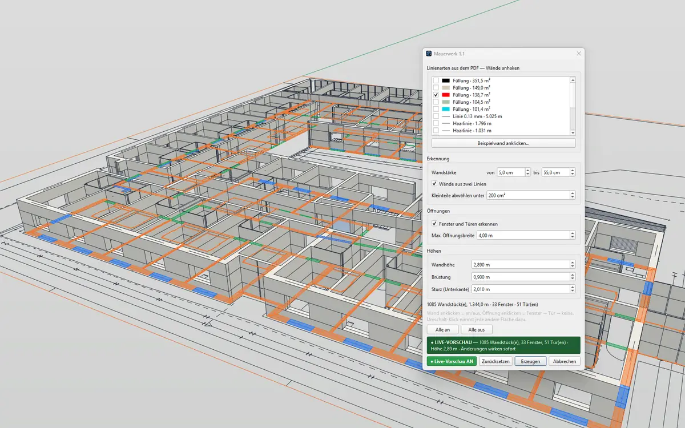

# Walls — masonry from the floor plan for IngeTrazo

Builds the **masonry** from an imported floor plan (PDF via **Plan Import**, DXF/DWG) as solids: walls at storey height, windows with parapet and lintel, doors with lintel. The walls are **preselected automatically** and corrected with a click.

[Deutsch → LIESMICH.md](LIESMICH.md)

## Installation
1. In IngeTrazo: **Extensions ▸ Open plugins folder** (Windows: `%APPDATA%\ingetrazo\plugins\`, Linux: `~/.local/share/ingetrazo/plugins/`).
2. Copy `walls_tool.py` into that folder.
3. Restart IngeTrazo → **Extensions ▸ Walls ▸ Walls from Plan…** (also on the right-click menu and as an icon on its own toolbar).

Requires IngeTrazo ≥ 0.5 (extension API 2).

## How to use
Select the floor plan (the plan group Plan Import made, or loose edges) and run **Walls from Plan…**. The preselection shows in the model:

- **orange** = wall · **blue** = window · **green** = door · dashed = switched off
- **Click a wall** to switch it on/off.
- **Click an opening** to switch window → door → no opening.
- **Shift-click** any other face of the drawing (a thick column, say) to add it as a wall.
- **Live Preview** (as in every PESI3D plugin): the masonry stands in the model at once and follows every change — so you see whether every wall was caught. **Reset** = default settings and preselection.
- **Follow selection**: select another floor plan and the walls follow; **↻ Read selection** reads the selection at once.
- **OK** keeps everything as **one group** (BIM: `IfcWall`) in one undo step; **Cancel** takes the preview back.

### Walls by line style (with Plan Import ≥ 1.2)
CAD programs draw cut walls their own way — usually filled, else with the heaviest pen. A sheet imported with **Plan Import 1.2** remembers how each line was drawn. The dialog then lists the **line styles from the PDF** (swatch, fill or stroke width, area or length):

- The likely wall style is **preselected** (a fill made mostly of narrow shapes, else the heaviest common pen).
- **Tick the walls**: fills become walls as they are, lines go through the line detection (below).
- **Click an example wall…**: then click a wall line or fill in the model — its style is switched on or off.
- Furniture, sanitary objects, dimensions and hatching are drawn in other styles and stay out by themselves.
- **Pockets**: unfilled areas walled in (almost) all round — seams between two fills, triangles at oblique wall corners, crossings, columns drawn with an X — are closed by themselves up to 0.3 m² when walled in all round or when their free edges carry the walls' own edges on (outer corners). Hairline cracks between two fills (under 1 cm) close in the solid by themselves. Bigger ones (installation shafts, cavities between double walls) show dashed: a click adds them.

Older imports and DXF/DWG have no line styles: the geometry detection applies.

### What is detected (by geometry)
- **Filled or hatched walls**: every thin closed face of the drawing between *wall thickness from … to*. Hatch lines do not split the wall.
- **Walls drawn as two lines** (no fill, gaps allowed): parallel line pairs at a wall's distance with no line between them.
- **Windows**: a window symbol in a gap of a wall (thinner strips, a glass line) or a glass line in the middle of a filled wall.
- **Doors**: an empty gap between two ends of the same wall (up to *Max. opening width*).
- **Not** a wall: stairs (rows of equal steps), dimension chains (extension lines with ticks), section and axis lines drawn across the plan.

### Small pieces
**Switch off pieces under … cm²** (default 200 cm²): smaller pieces lying in a window or door opening (frame profiles, filled like the wall) or lying loose start switched off. Small pieces hanging on a wall stay — CAD often cuts walls into many small fills. 0 = keep all.

Strip windows and glass facades wider than *Max. opening width* (default 4 m) stay open gaps — raise the value if needed.

### Heights
- **Wall height**: from the **Levels** panel (distance to the next level up), else the last value used.
- **Window sill**: underside of windows above the structural floor.
- **Lintel (underside)**: top of windows and doors.

Tip: crop the floor plan in Plan Import, so title block and frame stay out.

## Changelog
- **1.2** — Preview as in every PESI3D plugin: a **Source** row with *Follow selection* (select another floor plan and the walls follow) and *↻ Read selection*; buttons *● Live Preview ON · Reset · OK · Cancel*. Fixed: rebuilding the preview brought back an older selection. Screenshot of the Musterhaus example.
- **1.1** — **Live Preview** with banner, Reset. Unfilled **pockets** in the walls (corners, seams, crossings) are closed, shafts offered to click in. **Switch off pieces under … cm²**: frame profiles in openings and loose crumbs start switched off. Fixed: two equal halves of a fill (the triangles of a mitred corner) were taken for a duplicate — one went missing. Walls by **line style** (with Plan Import 1.2): list of line styles, wall fill preselected, **click an example wall**. Openings: windows with divided frames and rebates come out as one window, shafts between two walls are no longer doors, frame profiles drawn like the wall no longer split an opening. Layered walls are no longer taken for stairs. Errors show as a message (and go to `%LOCALAPPDATA%\IngeTrazo\walls_tool.log`). Much faster on big plans.
- **1.0** — first release.

## License
GPL-3.0-or-later · © 2026 Pesi (pesi3d.de) · [Imprint](https://pesi3d.de)
